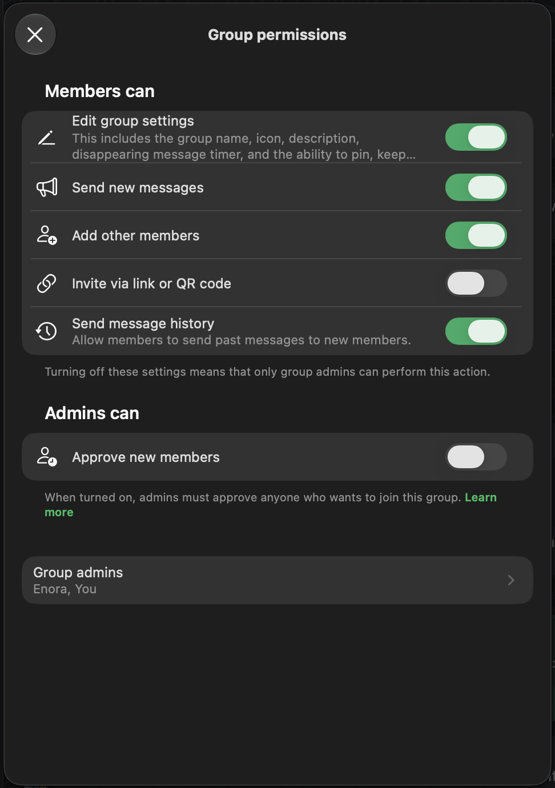

# Tasks

Stand 2026-10-28 (nach der Runde Editor-Leiste, Seitenleiste, Wischen, GUI-Prüfwerkzeug, Nextcloud, Selbst-Hosting; davor Kalender und Dienste, Testdaten, draw.io, Offline Runde 2; davor Notizen, Listen, Seitenleiste; ältere Befunde vom 2026-10-26). Aufgeräumt nach Git-Verlauf, docs/ und einer Durchsicht der laufenden App (Produktions-Build): Screenshots in fünf Größen (Desktop 1440, iPad quer 1180 und hoch 820, Handy 390 und 360 px) mit Seitenleiste offen und eingeklappt, Knopf-Test, Link-Prüfung, Ladezeit und Offline-Verhalten. Reihenfolge: Probleme → Aktiv → Ideen → Klären → Warten → Später → Erledigt.

Bilder: Bilddateien liegen in `docs/tasks/`; unter einem Task steht eine Zeile `  - `. Im Dashboard (dashboard.html) zeigt jede Karte ihre Bilder; „+ Add image“, Einfügen (Strg/Cmd+V mit dem Mauszeiger über der Karte) oder Hineinziehen legt die Datei dort ab und trägt die Zeile ein (beim ersten Mal fragt der Browser nach dem Projektordner).

Durchsicht 2026-10-26, ohne Befund: 77 interne Links von 30 Seiten öffnen fehlerfrei; rund 300 Knöpfe, Menüs und Reiter (Desktop und Handy) reagieren, keiner ist tot, keiner löst einen Konsolen- oder Netzwerkfehler aus (Knöpfe, die Daten ändern, wurden ausgelassen; iPad nur als Bild geprüft); `tsc` und `eslint` sind sauber. Das Testkonto hat keine Chats und keine Gruppen, deshalb sind Chat, Gruppe und Ausgaben-Werkzeug nicht im Bild geprüft (siehe unten).

## Probleme

### Offen für dich (Entwickler)
- [x] **~~Migrationen 061 bis 064 angewendet (2026-10-27)~~** - alle auf der Live-Datenbank, Datenbank-Tests grün

### Offline zuerst (Runde 1 und 2 erledigt 2026-10-27, Rest offen)
- [ ] **Lokale Datenbank und Warteschlange für alles** - gewünscht: Inhalte und Chats sind immer lokal da, das Netz dient nur dem Abgleich. Erledigt in Runde 1 und 2 (siehe Erledigt): Textkatalog nicht mehr in jeder Seite, Abfrage-Stempel statt Neuladen, Seiten aus Listen vorab behalten, Einstellung „Offline halten“ mit Speichergrenze, Notizen offline, IndexedDB (`src/lib/localdb.ts`) mit Chats, Warteschlange (`src/lib/queue.ts`) für Beiträge, Antworten, Stimmen auf Beiträge, Zusagen und Dienste. Entschieden 2026-10-27: nicht verschlüsselt, beim Abmelden gelöscht, Grenze einstellbar (Standard 500 MB). Offen:
  - (1) IndexedDB auch für Meine Inhalte, Gruppen und Anliegen der Umgebung; die Oberfläche zeigt zuerst das Lokale und gleicht im Hintergrund ab („Änderungen seit …“ statt ganzer Seite). Chats sind lokal (der Verlauf ergänzt offline eine ältere Seitenkopie), Seiten weiter als Kopien im Service Worker
  - (2) Warteschlange für die übrigen Arten: Ausgaben, Abstimmungen über Ziele, Kommentare an Initiativen, neue Gruppen, Termine anlegen; Konflikte über die vorhandenen Versionen
  - (3) Server-Sent Events oder Push statt Abfragen (heute: Stempel alle 20–60 s, ein offener Chat alle 4 s, nach zwei Minuten Ruhe 12 s und 30 s). Supabase Realtime wäre der Weg, braucht `alter publication supabase_realtime add table …` und eine Prüfung, dass `app.uid()` mit dem Supabase-JWT dieselben Zeilen freigibt
  - (5) Seitenwechsel ohne Server: Seiten sind Server-Komponenten, ein Wechsel holt immer Router-Daten (rund 10 KB). Ziel unter 20 KB ist erreicht, „ohne Server“ braucht (1)
  - [x] (6) draw.io auf Vercel (2026-10-28): nach dem Push von a77518e liefert hive-voice.vercel.app `/drawio/.version` (32.4.1), `/drawio/index.html` und `/drawio/js/app.min.js` (10 MB) aus. Noch einmal angemeldet ein Diagramm öffnen und im Netzwerk-Tab sehen, dass nichts von diagrams.net kommt
  - (8) Messbar: `e2e/performance.spec.ts` prüft das Gewicht der Seiten (unter 80 KB ungepackt, Abfrage unter 200 Byte); offen: Start ohne Netz in unter einer Sekunde und ein e2e-Test mit ausgeschaltetem Netz für alle Bereiche (heute nur Chat in `mine.spec.ts` und Notiz in `drafts.spec.ts`)
  - Umfang laut Antwort vom 2026-10-27: alles (Chats, ein paar Pinnwand-Beiträge, die bei Netz durch neue ersetzt werden, Anliegen, Notizen, Listen, Bilder)

### Offen aus der Runde vom 2026-10-28
- [ ] **Selbst-Hosting: Rest prüfen** - am 2026-10-29 auf diesem Mac im Modus `local` ganz durchgelaufen: Image bauen, Datenbank, Login, Dateispeicher, Migrationen, Orte, Registrieren, angemeldet bleiben, Onboarding, Notiz, Foto-Upload, Sicherung und Wiederherstellung. Offen: Tailscale mit einem echten Auth-Key (braucht dein Konto), Cloudflare und eigene Domain, ein Raspberry Pi, die Desktop-App einmal bauen und „Diesen Rechner als Server“ durchklicken. Vorher einmal den Workflow „Container image“ starten (Actions → Run workflow) und das Paket `hivevoice` in GitHub auf „Public“ stellen, sonst kann die Desktop-App das Image nicht laden
- [ ] **Daten aus der Cloud mitnehmen (Skript)** - heute Handarbeit (docs/selbsthosting.md, „Aus der Cloud herausziehen“): `pg_dump` der Schemas `public` und `auth`, Dateien aus dem Bucket `images`. Braucht die direkte Postgres-Verbindung als `postgres` (nicht die Migrations-Rolle)
- [ ] **Design: zweite Knopfart mit runden Ecken** - eigene Session (Wunsch vom 2026-10-28): wofür runde Knöpfe stehen (z. B. Filter und Umschalter gegenüber Aktionen), Entwürfe nebeneinander, dann einheitlich umsetzen. Die Suchfelder sind seit 2026-10-28 grau gefüllt, damit sie nicht wie Knöpfe oder Eingabezeilen aussehen
- [ ] **Mehr Icons statt Text** - erledigt: Editor-Leiste, Ansichten, Melden und Löschen unter Beiträgen. Offen: Durchgang durch Karten, Listen und Kopfzeilen (Teilen, Bearbeiten, Filter), gemeinsam mit der Design-Session
- [ ] **Durchsicht regelmäßig laufen lassen** - `npm run review` (siehe Erledigt) vor jedem Push mit Oberflächen-Änderungen; die Hinweise (Höhen, kleine Touch-Flächen) im Bericht abarbeiten

### Gemeldet (2026-10-27)
- [ ] **Speicher verbessern: ein Ordner auf dem Rechner** - bewusst nicht in der Runde vom 2026-10-27 (zuerst Editor, Listen = Notizen und Offline). Diagramme, Notizen, Links usw. liegen zusätzlich zur Cloud lokal in einem einzigen Ordner (Desktop-Programm, Tauri: `desktop/`, und Chrome/Edge über die Dateizugriffs-API) und werden in beide Richtungen abgeglichen. Dateien lassen sich außerdem von anderen Orten einbinden: man sagt nur, wo die .md-Datei liegt, und sie wird in der App angezeigt und bearbeitet (Verknüpfung statt Kopie). Entwurf: ein Abgleich-Kern in TypeScript mit einer Schnittstelle „Ordner“ (lesen, schreiben, löschen, Liste) und zwei Zugängen (Tauri-Befehle in Rust, Browser-Dateizugriff), getestet mit einem Ordner im Speicher. Dateiformat: Notiz = .md mit Kopfdaten (`id`, `version`, `title`, `tags`), Liste = dieselbe .md, Diagramm = .drawio.svg, Link = .md. Konflikt (beide Seiten geändert): die neuere gewinnt, die andere wird als Version gesichert. Das Dateiformat steht jetzt fest, weil Notiz und Liste eins sind
- [ ] **Erklärzeilen: Rest** - Durchgang 2026-10-27 durch alle Einleitungen (`*lead`, `*intro`, de und en): Werbesätze in Gemeinschaft, Gruppen, Personen, Anliegen, Wachsen, Wissen, Meine Inhalte gekürzt. Offen: die Leichte-Sprache-Fassungen (`messages/ls`) von Wachsen und Anliegen sind länger geblieben; Hinweiszeilen in Formularen (`hint`) einzeln ansehen

### Gefunden bei der Durchsicht (2026-10-26)
- [ ] **Berührungsflächen: Rest** - alle Kästchen und Auswahlfelder in Formularen sind seit 2026-10-27 24 px groß (WCAG 2.2), Unterziele auch. Offen: mit der Durchsicht als Werkzeug nachmessen (Ideen), besonders Kästchen im Notiz-Editor
- [ ] **Leichte Sprache lückenhaft** - 76 Überschreibungen in 17 von 50 Textbereichen (messages/ls), 33 Bereiche ganz ohne; Deutsch und Englisch sind vollständig (je 3.092 Texte plus die neuen). Braucht Menschen, die Leichte Sprache können, oder eine geprüfte Übersetzung
- [ ] **Avatar des Testkontos** - kein Fehler der App: das Konto hat ein 1 × 1 Pixel großes Testbild als Foto (Rest eines abgebrochenen e2e-Laufs, `features.spec.ts` lässt ein vorhandenes Foto in Ruhe). In Einstellungen „Foto entfernen“

## Aktiv
- [ ] **Kalender und Dienste: nächste Schritte (F01, F02)** - Grundbaustein steht (siehe Erledigt). Offen: Monats- und Wochenraster neben der Liste; Erinnerung per Mail (nach der eigenen Domain); Tauschen zweier Dienste mit Bestätigung der anderen Person (heute: übernehmen, Vertretung suchen, Admins teilen ein); Termine als Kachel in der „Heute“-Übersicht unter Ich; öffentliche Termine nach Entfernung statt nur „bei dir / weitere“; Termin aus einem Chat heraus vorschlagen; Ausgabe als ActivityPub-`Event`, sobald die Föderation weitergeht
- [ ] **Zeitfenster und Buchen (F03, 7)** - wiederkehrende Verfügbarkeit an Angeboten („Gassi Di und Do 17 Uhr“), Räume, Geräte und Sprechstunden buchen, Konflikte erkennen
- [ ] **Gemeinsames Geld (F04, 9)** - „Ausgaben teilen“ ist gebaut (2026-10-23, siehe Erledigt). Offen: Kassenbuch mit Belegen (für Mitglieder oder öffentlich), Beiträge, Spenden, Alles-oder-nichts (Schema `funding_campaigns`/`pledges` existiert). Zahlung nur über externe Anbieter, die Plattform hält nie Geld
- [ ] **Politische Verantwortung tragen können** - HiveVoice soll politische Veränderung bewirken und Verantwortung dauerhaft tragen. Personas: Rainer (frustriert), Sophie (will Verantwortung), Mia (16), Olena (ohne Wahlrecht), Stefan (Bürgermeister), Claudia (Stadträtin)
  - [ ] **Geführter Einstieg „Ich will etwas ändern“ (F15)** - in eigenen Worten oder per Auswahl und Ort sagen, was stört; die App zeigt ähnliche Anliegen, Gruppen, Zuständige und den kleinsten nächsten Schritt (Embeddings vorhanden)
  - [ ] **Wirkung sichtbar (F16)** - Verlauf jeder Initiative und Anfrage bis zur Umsetzung, Zusagen mit Termin und Status, Mitteilung an alle, die mitgemacht haben. Wichtigster Hebel gegen Frust
  - [ ] **Mängel auf der Karte (F20)** - melden mit Foto und Ort, ähnliche Meldungen bündeln, Status bis „erledigt“, geht an die Zuständigen
  - [ ] **Fragen und informieren von oben (F17)** - Zuständige befragen die Betroffenen eines Gebiets (offen oder ausgelost wie die Jury), Ergebnis öffentlich, Pflicht zur Rückmeldung, was daraus wurde; Mitteilungen nur mit Opt-in
  - [ ] **Mandatsprofil (F19)** - Abstimmungen mit Begründung, Zusagen, Sprechstunde (F03), Team-Zugang fürs Büro, beleidigende Nachrichten vorsortieren (nicht löschen)
  - [ ] **Wahlen von Personen und Ämter auf Zeit (F05)** - Vorstand, Kassenprüfung, Delegierte, Komitee; Amtszeit mit Ende, Rechenschaft beim Abgeben, Rotation
  - [ ] **Szenario Müllabfuhr ausarbeiten** - Kwame (Persona 29): Viertel in Westafrika organisiert die Müllabfuhr selbst. Durchspielen mit F23 (SMS/USSD), F04 (Mobile Money, öffentliche Kasse), F02, F20, F25, F05, F22; Ergebnis in docs/ festhalten
  - [ ] **Szenario Bürgermeister ausarbeiten** - Stefan (Persona 23): einen Monat Gemeindealltag mit HiveVoice durchspielen, danach F17, F18 (Bürgerhaushalt), F19, F20, F29 (Ratsinformationssystem) priorisieren
  - [ ] **Was braucht dauerhafte Verantwortung?** - Übergaben, Amtszeiten, Vertretung, Rechenschaft, Geld und Haftung; mit docs/rechte.md abgleichen und Lücken als Tasks eintragen
- [ ] **Firmen und Organisationen integrieren** - Interessen der Bevölkerung werden zu keinem Zeitpunkt beschnitten. Personas: Julia (Einzelunternehmen), Frank (Mittelstand), Katrin (Großunternehmen), Giuseppe (Laden), Anna (Hof); NGOs: Birgit (klein), Jan (groß), Kwames Komitee
  - [x] Drei Firmen- und drei NGO-Personas erstellt und abgeglichen (docs/personas.md)
  - [ ] **Leitplanken festschreiben** - Organisationen stimmen nicht ab, unterstützen nicht und starten keine Initiativen; wer für eine Organisation spricht, ist gekennzeichnet; Hervorhebung nie bei Initiativen, Argumenten, Abstimmungen, Zuständigkeiten; Deckel pro Ort (docs/personas.md, Abschnitt 6). Zuerst, vor allen Teilaufgaben unten
  - [ ] **Organisationsprofil (F07)** - Firma, NGO, Partei, Amt als Akteur mit mehreren Personen, Rollen und Impressum. Vorschlag: Gruppe mit Art „Organisation“, damit Rechte, Rollen und Übergabe schon funktionieren
  - [ ] **Geschützte Arbeitsräume (F08)** - IP wahren: Vertraulichkeits-Hinweis, Weitergeben und Export gesperrt, Zugriffsprotokoll, Wasserzeichen
  - [ ] **Waren und Dienstleistungen anbieten (F09)** - Orte mit Öffnungszeiten, „jetzt offen“, Tagesangebot, reservieren und abholen, Orten folgen. Erster Schritt: Öffnungszeiten als Feld an Angeboten
  - [ ] **Mitarbeitende suchen (F10)** - Stellen mit Pflichtangaben (Lohnspanne, Stunden, Sprache), Bewerben mit Profil, Aufträge mit Kostenvoranschlag, Abschlussarbeiten
  - [ ] **Werbung für Projekte (F12)** - bezahlte, gekennzeichnete Hervorhebung zu festem Preis, ohne Tracking
- [ ] **Fähigkeiten, Referenzen, Patenschaften (F11, 9)** - Fähigkeiten und Sprachen im Profil, Bestätigung nach erledigtem Austausch (Text, keine Sterne), Engagement-Nachweis mit Stunden, „Nachweis liegt vor“ (z. B. Führungszeugnis), Mentoring. Erster Schritt: Fähigkeiten als Tags am Profil
- [ ] **Übersetzen und mehr Sprachen (F22, 6)** - Beiträge und Chats auf Knopfdruck übersetzen; weitere Oberflächensprachen (TR, AR, UK, PL)
- [ ] **Themenkreise ohne Ort (F13, 5)** - Interessen folgen, überregionale Kreise, daraus lokale Treffen. Erster Schritt: den vorhandenen Tags folgen
- [ ] **Zugang ohne Smartphone oder Adresse (F23)** - SMS/Telefon, Stellvertretung mit Protokoll („Enkel hilft Opa“), Konto ohne Meldeadresse, sicher auf öffentlichen Geräten
- [ ] **Barrierefreiheit (F24)** - Vorlesen, Sprechen statt Tippen, Barriere-Angaben an Orten und Treffen. Berührungsflächen und abgeschnittene Texte stehen unter Probleme
- [ ] **Struktur Gemeinschaft · Freunde · Ich ausbauen** - Umbau und Regeln stehen (docs/struktur.md). Offen: „Heute“-Übersicht unter Ich (heute zeigt der Überblick nur Inhalte; Kalender gibt es seit 2026-10-27), Rechtegruppen frei benennen, Leichte-Sprache-Texte für die neuen Bereiche (siehe Probleme), Bilder und Texte als eigene Inhaltsart
- [ ] **Oberfläche, weitere Runden** - erste Runde erledigt. Offen: Formulare mit vielen Feldern (Anliegen anlegen, Gruppe gründen, Initiative) und die Einstellungen visuell durchgehen; Erklärtexte bündeln (z. B. eine Seite „So funktionieren Vorschläge“ statt Hinweisen an vielen Stellen); Befunde aus der Durchsicht stehen unter Probleme

## Ideen
- [ ] **Feedback-Anwendungsfall** - was, wenn jemand, die eine App baut, Rückmeldungen von vielen Menschen will? HiveVoice als Ort, um anderen Projekten und Webseiten Feedback zu geben
  - [ ] Rückmeldungen zu fremden Projekten und Webseiten sammeln und bündeln
  - [ ] Anmerkungen auf Screenshots zeichnen (der Bildeditor mit Stift, Pfeil und Text aus 3e1f97c ist die Grundlage)
- [ ] **Pinnwand-Filter „Passt zu mir“** - automatischer Filter für die Pinnwand in Gemeinschaft (docs/struktur.md): woraus er sich speist (Ort, Tags, Sprache, Gruppen, Embeddings), wie man ihn sieht und korrigiert, gespeicherte eigene Ansichten
- [ ] **Live-Zusammenarbeit an Dokumenten** - bisher nur Sperre und Versionen. Weg laut docs/open-source.md: Yjs mit y-codemirror.next im Notiz-Editor (erst offline zusammenführen), dann Hocuspocus als Dienst (MIT)
- [ ] **Aus docs/open-source.md** - Schedule-X (MIT) für Monat und Woche im Kalender, Aufgaben als VTODO über CalDAV, öffentliche Termine als ActivityPub-`Event` (Mobilizon, Gancio), Matrix-Brücke für Chats
- [ ] **Föderation über Stufe 1 hinaus** - Remote-Profile sind höchstens Stufe 1, mehr ist noch nicht gebaut
- [ ] **Später aus docs/personas.md, erst mit einem konkreten Partner** - F06 Anträge und Änderungsanträge (Partei, Verband), F18 Bürgerhaushalt (Gemeinde), F21 Stimmen delegieren, F25 anonyme Hinweise (rechtlich heikel), F26 Lage-Modus für Krisen (Hilfsorganisation), F14 Sammlungen und Tauschlisten, F27 Vertrauen bei Tieren/Kindern/Schlüsseln, F28 Pressebereich, F29 Schnittstellen und Export

## Klären
- [ ] **Offene Fragen aus docs/personas.md** - (1) Auch außerhalb Deutschlands (dann F22, F23, Mobile Money früher)? (2) Organisationen als eigene Konten oder Gruppenart? (3) Wahlen von Personen als eigene Funktion oder als Art von Ziel? (4) Ab welchem Alter zählen Stimmen bei Initiativen verbindlich? (5) Testpartner: welche Gemeinde, welcher Verein, welche Partei?
- [ ] **Kanäle in Gruppen** - brauchen Gruppen Kanäle wie in Teams oder reichen Untergruppen? (docs/struktur.md)
  - Vorbild für Rechte je Gruppe (Signal, „Group permissions“): Mitglieder dürfen Einstellungen ändern, Nachrichten senden, Mitglieder hinzufügen, per Link oder QR einladen, Verlauf weitergeben; Admins genehmigen neue Mitglieder; Liste der Admins
  - 

## Warten auf den Betreiber
- [ ] **Rechtstexte festlegen** - Checkliste in docs/betrieb.md; Datenschutztext nennt alle Dienste. Offen: Impressum-Angaben, Rechtsgrundlagen, AV-Verträge, DSA-Kontaktstelle, Umgang mit Behördenanfragen – vom Betreiber zu klären und prüfen zu lassen (Anleitung: docs/betrieb.md, Abschnitt Rechtstexte)
- [ ] **Eigene Adresse für Supabase** - Pro-Plan, Add-on „Custom Domain“ (rund 10 $ im Monat) und eine Domain; Schritte in docs/betrieb.md. Erst nach der Behebung des Login-Fehlers (siehe Probleme)
- [ ] **Desktop-Programme signieren** - ohne Apple Developer (99 $ im Jahr) und Windows-Zertifikat warnen die Systeme beim ersten Start; den Tauri-Updater-Schlüssel (`~/.tauri/hivevoice.key`) sicher aufbewahren und als GitHub-Secret anlegen (docs/desktop.md). Offen: Google blockiert die Anmeldung in eingebetteten Webansichten teils („disallowed_useragent“)

## Später
- [ ] **2FA für Admins (beim Wechsel vom MVP zum Betrieb)** - Seite zum Einrichten von TOTP/Passkey und Code-Abfrage beim Anmelden (Supabase MFA), dann `ADMIN_REQUIRE_MFA=1` setzen; danach Sudo-Modus (frische Anmeldung für gefährliche Aktionen) und Mail bei Admin-Anmeldung von neuem Gerät (docs/betrieb.md, Abschnitt Admins)
- [ ] **Ein Zugriffsmodell in der Datenbank** - Oberfläche ist vereinheitlicht (Teilen → Zugriff), aber Dokumente (visibility, edit_mode, resource_grants mit Stufen und Ablauf) und Einträge/Aufgaben (read_scope, write_scope, object_grants) speichern es noch verschieden; zusammenführen braucht neue Policies auf der Live-Datenbank
- [ ] **Mehrsprachiges Embedding-Modell** - gte-small ist für Deutsch schwach; multilingual-e5-small in der Edge Function, Schwelle neu eichen (docs/markt.md)
- [ ] **Unabhängigkeit Stufe 1** - Speicher-Schicht mit S3, SMTP statt Resend, `EMBEDDING_URL`, Codeberg-Spiegel (docs/unabhaengigkeit.md)
- [ ] **eID-Anbindung** - Modus `eid` ist vorbereitet, aber noch kein eID-Dienst angebunden
- [ ] **Virenscanner für Uploads** - `scan_status` existiert, aber kein Scanner; braucht einen Dienst außerhalb der App
- [ ] **Aufräumen gelöschter Dateien im Speicher** - nach 30 Tagen Papierkorb bleibt die Datei unlesbar im Speicher liegen, bis sie jemand mit dem Service-Schlüssel entfernt (Cron-Job oder Edge Function)
- [ ] **Auffälligkeiten pro IP erkennen** - „viele neue Konten von einer Adresse“; braucht Edge/WAF
- [ ] **Oberfläche für Notfallzugriff auf Chats** - DB-Funktionen (Antrag, zweite Freigabe, Protokoll) sind da, Lese-Oberfläche bewusst noch nicht gebaut

## Erledigt
- [x] **~~Entwicklungsprozess und Fehlersuche (2026-10-30)~~** (docs/debugging.md)
  - **Fehlerberichte**: Browser und Server zählen Fehler und Ladezeiten in unserer Datenbank (Migration 069, `npm run reports`), ohne Fremddienst und ohne Personenbezug, 30 Tage
  - **Handy**: `npm run phone` (Touch-Gesten, Bildraten, Video, gedrosselte CPU, echtes Android über adb), `npm run phone:ios` (Simulator filmen), `npm run phone:frames` (Video in Einzelbilder)
  - **Tests**: `npm run test:local` auf eigener Datenbank in Docker, in Sekunden und ohne Live-Daten; der Jury-Test brauchte bisher echte Konten
  - **CI**: `.github/workflows/ci.yml` prüft jeden Push
- [x] **~~Wischen, untere Leiste, Navigationsleiste, Dunkelmodus (2026-10-29)~~**
  - **Wischen am Handy flüssig**: die Nachbarteile werden vorab geladen, die Seite folgt dem Finger 1:1, gleitet beim Loslassen (oder bei einem schnellen Wisch) ganz hinaus, und der neue Teil gleitet von der anderen Seite herein; auch bei Freunde (Filter `?f=`)
  - **Untere Leiste rutschte weg**: beim schrägen Ziehen wurde die Seite durch das Verschieben breiter als der Bildschirm und ließ sich samt Leiste verschieben. Jetzt kann der App-Rahmen nie seitlich scrollen (`[data-shell] { overflow-x: clip }`), und solange ein Wisch läuft, bewegt der Browser die Seite nicht (e2e prüft beides mitten im Wischen)
  - **Android-Navigationsleiste**: das Manifest gab Android Schwarz vor (`theme_color: #111111`), jetzt das Weiß der unteren Leiste. Auf dem Handy wirkt das erst, wenn Chrome die installierte App aktualisiert (kann ein paar Tage dauern; schneller: App entfernen und neu installieren)
  - **Dunkelmodus**: die App folgt jetzt dem Gerät (Migration 068: Standard „Wie Gerät“, die nie gewählte Voreinstellung „Hell“ wird zu „Wie Gerät“); wer immer hell oder dunkel will, wählt es unter Einstellungen → Darstellung. Alle Seiten in fünf Größen im Dunkeln geprüft (`REVIEW_DARK=1 npm run review`, mit neuer Kontrastprüfung nach WCAG): kein Kontrastfehler
- [x] **~~Editor, Seitenleiste, Wischen, GUI-Prüfwerkzeug, Nextcloud, Selbst-Hosting (2026-10-28)~~**
  - **Notiz-Editor**: alle Werkzeuge als Icons mit Namen und Tastenkürzel im Tooltip (⌘/Strg+B, I, K), die Ansichten (Dargestellt, Quelltext, Liste) als Icons in derselben Reihe; was nicht passt, geht von rechts in ein „⋯“-Menü (`src/components/editor/Toolbar.tsx`). Bilder in Notizen lassen sich an der Ecke breiter und schmaler ziehen (Doppelklick: Originalgröße, Tastatur: Pfeile); die Breite steht wie bei Obsidian im Text (``) und gilt auch in der Leseansicht
  - **Fehler**: „Mit Aufgaben“ sprang zu „Notizen“ zurück (die von selbst geöffnete erste Notiz verlor den Filter); in Einzelchats „Link im Chat ablegen“ statt „Wissen in der Gruppe hinzufügen“; der Daumen-runter-Knopf war 16 px breit; der Datenbank-Pool wurde beim Laden gebaut (Docker-Build ohne Datenbank brach ab)
  - **Seitenleiste**: ein Viertel schmaler (200 statt 248 px), der Bereichsname steht neben dem Einklapp-Knopf (nichts springt mehr beim Aufklappen), Gemeinschaft, Freunde und Ich immer untereinander mit Text rechts vom Icon, Darüberfahren schiebt die Seite wie ein Klick
  - **Oberfläche**: Suchfelder grau gefüllt ohne Rahmen (Knopf und Suchfeld, Suchfeld und Eingabezeile sahen gleich aus), „+ Neu“ unter Ich schwarz wie die anderen Neu-Knöpfe, Reiter, die nicht passen, gehen ganz ins „Mehr“-Menü statt halb dahinter (`TabRow`), Melden und Löschen unter Beiträgen als Icons, größere Ziele im Filtermenü, in der Terminliste und in der Fußzeile
  - **Wischen am Handy**: nach links zum nächsten Teil des Bereichs (Überblick → Anliegen → Kalender → Notizen …), nach rechts zurück, in Gemeinschaft, Freunde und Ich; nicht in Eingabefeldern, im Editor, auf Karten und in Reihen, die selbst seitlich scrollen (`src/components/shell/Swipe.tsx`)
  - **GUI-Prüfwerkzeug** (`npm run review`, `tools/review/`): 27 Seiten in fünf Größen, jede auch nach dem Aufklappen jedes Menüs; prüft seitliches Scrollen, Herausragen, Überlappen (Bedienelemente und Text, getrennt nach Ebenen), abgeschnittenen Text, zu kleine Ziele, gleich aussehende verschiedene Bedienelemente untereinander, runde Ecken, ungewöhnliche Höhen, Bedienelemente ohne Namen und Konsolenfehler; Bericht in `test-results/review/report.md`. Der erste Lauf fand die Fehler oben; jetzt 0 Fehler
  - **Nextcloud** (docs/nextcloud.md, Migration 067): persönlich und für Gruppen, Verbinden über Nextclouds Anmeldung (App-Passwort, verschlüsselt in Supabase Vault, nur der Server liest es), ein Kalender erscheint im eigenen oder im Gruppenkalender, die eigenen HiveVoice-Termine lassen sich in Nextcloud abonnieren, ein Ordner als Fotogalerie (Ich → Uploads, Gruppenwerkzeug „Nextcloud“) mit Unterordnern und Hochladen; nur öffentliche https-Adressen, nichts außerhalb des Ordners. Mit einer echten Nextcloud im Container durchgetestet
  - **Selbst-Hosting** (docs/selbsthosting.md, docs/raspberry-pi.md, `selfhost/`): Datenbank, Login, Dateien, App und Caddy als eine Adresse; Zugang lokal, über Tailscale Funnel, Cloudflare-Tunnel oder eigene Domain; `setup.sh` erzeugt die Geheimnisse, lädt die Orte und richtet alles ein, `backup.sh` sichert und stellt wieder her; Login und Dateien liegen unter derselben Adresse wie die Seiten, egal unter welcher man sie öffnet (Heimnetz, localhost, Tunnel), ein Image für jede Adresse; Workflow „Container image“ baut es für x86 und ARM; Desktop-App: Einstellungen → „Diesen Rechner als Server“ (macOS, Linux). Lokal ganz durchgetestet (siehe Probleme für den Rest). Gefunden und behoben beim Test: Rollen-Skript brach die Einrichtung der Datenbank ab, Gesundheitsprüfungen über IPv6, `postgres` fehlte im Image, App-Rolle vor den Migrationen, Weiterleitungen auf die Container-Adresse (`0.0.0.0:3000`, jetzt `getOrigin()`), Login über eine andere Adresse als die Seite, Dateispeicher in einem Mac-Ordner ohne erweiterte Attribute (jetzt Docker-Volume), leere Ortsliste sperrte das Onboarding
  - **Fehler aus dieser Runde selbst, behoben**: die Suspense-Grenze für das Wischen ließ in Gemeinschaft und Ich den Seiteninhalt nicht interaktiv werden (Reiter reagierten nicht); die Reiterleiste misst jetzt auch, wenn die Schrift nachlädt
  - **Recherche** (docs/open-source.md): was wir einbinden (CalDAV, WebDAV, Yjs, Schedule-X, ActivityPub, Matrix-Brücke) und was nicht (Planka: keine Open-Source-Lizenz, Focalboard: nicht mehr gepflegt)
  - **Tests**: `tests/nextcloud.test.ts`, `tests/db.test.ts` › nextcloud, `tests/editor.test.ts` (Bildbreite), `tests/dbRetry.test.ts`; e2e `editor-and-swipe.spec.ts` (Leiste, Bildbreite, „Mit Aufgaben“, Wischen), `nextcloud.spec.ts`, Seitenleiste und Neu-Menü angepasst
- [x] **~~Kalender und Dienste, Testdaten, draw.io, Offline Runde 2 (2026-10-27)~~**
  - **Kalender (F01)**: Migration 065/066 (`public.events`, Rollen, Eingeladene, Zu-/Absagen je Termin, Änderungen je Termin, `app.calendar`, `app.event_times` mit Wiederholung in Ortszeit über die Zeitumstellung). Termine persönlich (privat mit Eingeladenen oder öffentlich), in Gruppen (neues Werkzeug „Kalender und Dienste“, auch im Chat zu zweit) und an „Kurse & Treffen“-Anliegen. Zusage, Vielleicht, Absage je Termin einer Serie, mit Rolle („Geige: 1 fehlt“), Notiz und Höchstzahl. Absagen einzelner Termine oder der ganzen Serie, mit Mitteilung an alle, die zugesagt haben. Seiten: Ich → Kalender (Woche, 4 Wochen, 3 Monate, blättern), Gemeinschaft → Termine (bei dir zuerst), Terminseite `/events/[id]?at=…`, Neu-Menü „Termin“
  - **Dienste (F02)**: ein Dienst ist ein wiederkehrender Gruppentermin mit Reihenfolge; wer dran ist, ergibt sich aus der Nummer des Termins. Übernehmen, Vertretung suchen (die anderen in der Reihenfolge hören davon), erledigt abhaken, Admins teilen ein; „Zuletzt: …“ auf der Terminseite. WG und Paar bekommen das Werkzeug als Vorlage
  - **Erinnerungen und iCal**: Mitteilung einen Tag und eine Stunde vorher (pg_cron über `app.tick`, je Person abschaltbar), Abo-Adresse mit geheimem Schlüssel (`/api/calendar/<Schlüssel>.ics`, mit Alarmen, neu erzeugbar), einzelner Termin als `.ics`
  - **Testdaten** (`npm run db:seed:test`, `supabase/seed/test/`): Mia und Jonas mit ihren öffentlichen Beispielen wieder da, 19 Beispielpersonen in Berlin, Hamburg, Köln, Leipzig, Freiburg, Rostock, Dresden, Frankfurt, Hannover, Augsburg und in Wien, Zürich, Amsterdam, Paris, Kraków, Bologna, Barcelona, København (Länder und Städte als Regionen) mit Angeboten und Gesuchen, die zueinander passen (Mitfahrt Berlin ↔ Leipzig, Bohrmaschine München ↔ Augsburg), öffentlichen Gruppen mit Terminen und Pinnwand-Beiträgen; das Testkonto bekommt einen Chat mit Lena und eine WG mit Ausgaben, Kalender und Putzplan. Alles ist Beispiel und geht mit „Beispiele entfernen“ wieder weg
  - **draw.io selbst ausgeliefert**: `scripts/drawio.mjs` (vor `npm run build`) holt v32.4.1 mit Prüfsumme nach `public/drawio/` (nicht im Git), der Editor läuft unter `/drawio` ohne Aufrufe zu diagrams.net und bleibt nach der ersten Benutzung offline nutzbar; ohne Download weiter embed.diagrams.net
  - **Offline Runde 2**: IndexedDB auf dem Gerät (`src/lib/localdb.ts`), Chats bleiben dort und ergänzen offline eine ältere Seitenkopie; Warteschlange (`src/lib/queue.ts`) für Beiträge, Antworten, Stimmen auf Beiträge, Zusagen und Dienste, mit Hinweis „1 Änderung wartet auf Verbindung“ und Meldung, wenn der Server etwas ablehnt; Speichergrenze unter „Offline halten“ (100 MB, 500 MB, 2 GB, so viel wie möglich; Bilder gehen zuerst), der Browser wird gebeten, nichts von selbst zu löschen; Abmelden löscht auch die lokale Datenbank
  - **Oberfläche**: Kästchen und Auswahlfelder 24 px, Werbesätze in Einleitungen gekürzt
  - **Hängende Datenbank-Verbindungen**: der Pooler verwirft Verbindungen, ohne dass die App es merkt (nach Ruhezeit oder Netzwechsel); eine Abfrage darauf wartete ewig, nach fünf solchen hing jede Seite. Jetzt gilt in `asViewer` eine Frist von 30 s: danach wird der Pool ersetzt und die Arbeit einmal auf einer neuen Verbindung wiederholt (`withDeadline` in `src/lib/dbRetry.ts`, getestet)
  - **Tests**: Datenbank (Kalender: Wiederholung über die Zeitumstellung, Rollen, Rechte, Gäste, Öffentlich, Höchstzahl, Dienste, Erinnerungen, Feed), `tests/calendar.test.ts` (Zeitzonen, iCal), e2e `calendar.spec.ts` (Gruppe, Termin mit Rolle, Zusage, Dienst, Abo) und `offline-queue.spec.ts`
- [x] **~~Notizen, Listen, Teilen, Seitenleiste, Oberfläche, Offline Runde 1 (2026-10-27)~~**
  - **Notiz-Editor** (`src/components/editor/`, `NoteEditor.tsx`): CodeMirror 6 statt Textfeld und Vorschau. Der Text bleibt Markdown (nichts wird umgewandelt oder geht verloren), wird aber beim Tippen so gezeichnet, wie er aussieht: Überschriften, fett, kursiv, Listen mit Punkten, Kästchen zum Anklicken, Bilder, Diagramme, Tabellen, Formeln, Mermaid. Die Zeichen erscheinen nur dort, wo der Cursor ist und der Editor den Fokus hat. Ansichten „Dargestellt“, „Quelltext“ und „Liste“; alle Knöpfe der Leiste bleiben (zweiter Klick nimmt Fett usw. wieder weg) und dazu „Aufgabe“. Einfügen und Ziehen von Bildern wie bisher. Die Bibliothek wird nur auf Seiten mit Notizen geladen
  - **Notizen speichern sich immer**: neue Notizen entstehen privat, sobald es etwas zu speichern gibt (Titel oder Text), und speichern sich danach 1,2 s nach jeder Änderung (eine Version je Sitzung); „Notiz veröffentlichen“, „Speichern“ und „Schließen“ entfallen, „Bearbeiten“ auch (die Notiz ist der Editor). Ohne Netz bleibt der Text auf dem Gerät und geht beim nächsten Netz raus. Beschreibung und Hashtags sind eingeklappt; ohne Titel nennt die erste Zeile die Notiz. Wer nur vorschlagen darf, schickt weiter mit einem Knopf
  - **Listen sind Notizen mit Aufgaben** (`- [ ]`): eine Datei, zwei Ansichten. Migration 062 wandelt alte Listen samt Freigaben und Link-Schlüssel um (alte Tabellen bleiben), „Mit Aufgaben“ ersetzt „Listen“ in der Seitenleiste, alte Adressen (`/me/lists/…`) führen zur Notiz. Listenansicht: Fortschritt, Gruppen aus Überschriften, abhaken, umbenennen, verschieben, löschen, neuer Punkt
  - **„Wo teilen?“** mit „Nicht teilen (nur für mich)“ als erster und vorbelegter Wahl für Links und Dateien (`ShareTarget`), „Wer darf das sehen?“ ist darin aufgegangen, der Knopf heißt „Speichern“, bis ein Ort gewählt ist. Notizen fragen beim Anlegen nichts: Teilen kommt danach über „Teilen“
  - **Ein „Neu“-Menü** (`src/components/new/items.ts`): Anliegen, Chat, Gruppe, Initiative, Pinnwand-Beitrag, Notiz, Liste, Diagramm, Hochladen; auf /new, in Ich → Neu und über „+“ am Handy
  - **Texte**: Werbesätze entfernt („In Markdown, mit Versionen …“ und Verwandte), Knopf „Diagramme“ statt „draw.io“, kein Mermaid-Knopf mehr (Mermaid-Blöcke werden weiter gezeichnet und lassen sich nach draw.io weiterbearbeiten)
  - **Seitenleiste wie Chrome**: Klick klappt dauerhaft ein oder aus (Cookie), ein Zeiger darüber öffnet eine eingeklappte vorübergehend über der Seite (ohne sie zu verschieben, mit kurzer Verzögerung), Tastatur-Fokus auch. Unter 1100 px (iPad hochkant) bleibt sie eine Leiste mit Symbolen, der Knopf öffnet sie darüber, bis man woanders hin geht
  - **Oberfläche**: Kopfzeile bei 820 px (Suchfeld überdeckt nicht mehr den Schriftzug), Bereichsleiste („Gemeinschaft“ passt), Handy-Freunde (Ursache: `[&>*]:w-full` machte die unsichtbare Überschrift 100 % breit und die Seite 15 px zu breit), untere Leiste mit festen Spalten, Reiter und Filter blenden am Rand aus, solange es weitergeht, Kachelbeschreibungen nicht mehr abgeschnitten, Berührungsflächen größer, leere Freunde-Liste sagt es nur einmal, Einstellungen ohne doppelten Titel, Profil ohne doppelten Avatar
  - **Technik**: Datenbank-Zugriffe mit Zeitlimit (20 s je Anweisung, 10 s Sperre, Verbindungsaufbau 10 s) und einer Wiederholung bei abgebrochener Verbindung vor dem Abschluss (`src/lib/dbRetry.ts`, getestet), Migration 063 setzt dieselben Grenzen für die App-Rolle; draw.io-Editor mit Hinweis und „Noch einmal versuchen“, wenn er sich nach 15 s nicht meldet; e2e meldet sich einmal vor allen Tests an (`globalSetup`, Sitzung in `node_modules/.cache`, kein Wettlauf mehr bei mehreren Workern)
  - **Offline Runde 1**: Textkatalog nicht mehr in jeder Seite (er ist Teil der Programmdateien: HTML von rund 200 KB auf 50 bis 65 KB, gepackt etwa 10 bis 13 KB), Abfrage-Stempel statt Neuladen (`/api/stamp`, 40 Byte statt rund 52 KB je Abfrage, ganze Seite nur bei Änderung und alle 5 Minuten), Chat-Abfrage gestaffelt (4 s, nach 2 Minuten Ruhe 12 s, nach 10 Minuten 30 s), die Seiten der ersten Einträge jeder Liste werden vorab behalten, Einstellungen → „Offline halten“ (Texte und Bilder, nur Texte, nichts; Bilder nur im WLAN; Speicher anzeigen; löschen), Service Worker hält `/drawio/` nach erster Benutzung
  - **Tests**: `tests/editor.test.ts` (Aufgaben, Knöpfe, Live-Ansicht, 15), `tests/dbRetry.test.ts`, Datenbank (Notizen, Listen; brauchen Migration 061/062), e2e (Notiz, Liste, Seitenleiste, Gewicht der Seiten, offline) angepasst
- [x] **~~Anmeldung wurde überschrieben (2026-10-26)~~** - seit b936e4c schrieb `src/proxy.ts` das Tages-Cookie unter dem Namen des Login-Cookies mit dem Wert „1“ (ein `name` in den Cookie-Optionen ersetzt den Namen); schon die erste Seite wurde als Gast gezeigt. Jetzt `cookieAttributes` ohne Namen und `touchSession` in `src/lib/supabase/touch.ts`; Test in `tests/touch.test.ts` (prüft die gesendeten `Set-Cookie`-Zeilen) und `e2e/login.spec.ts` („zweiter Aufruf bleibt angemeldet“); `e2e/auth.ts` bricht jetzt ab, wenn nach der Anmeldung „Du liest als Gast“ steht
- [x] **~~Ausgaben teilen (2026-10-23)~~** - Werkzeug für Gruppen und 1-zu-1-Chats: wer was wann bezahlt hat, gleich, nach Beträgen, Prozent oder Anteilen teilen, Belege als Foto oder PDF, Salden, wenigste Zahlungen zum Ausgleichen, Löschen und Wiederherstellen, Mitteilungen; neue Gruppenvorlage WG
- [x] **~~Notizen, Diagramme, Entwürfe (2026-10-22)~~** - Notizen nur als Text mit Auge und Spalten, LaTeX-Formeln, Bilder; Abschnitt Diagramme unter Ich mit draw.io (gespeichert als SVG mit Zeichnung, Versionen, Teilen, Papierkorb, Download), draw.io in Notizen, Mermaid-Block lässt sich nach draw.io weiterbearbeiten, Darstellung im dunklen Modus fest hell; nichts Getipptes geht verloren (Entwürfe bleiben auf dem Gerät bis zum Senden, werden beim Abmelden gelöscht; Notizen und Diagramme speichern sich beim Ändern selbst)
- [x] **~~Weitere Funktionen (2026-10-22)~~** - Fotos vor dem Teilen bearbeiten (Stift, Rechteck, Kreis, Pfeil, Text); Menschen aus Personen einladen (WhatsApp, Telegram, SMS, Mail, Teilen-Menü, Link, QR; persönlicher Code, solange die Anmeldung einen braucht); Karte mit Knopf zum eigenen Standort und Anliegen am Mittelpunkt ihrer Postleitzahl; Pinnwand-Filter „Reichweite“; Beispielinhalte (je Art eins, in der Verwaltung ein- und ausschaltbar); Föderations-Postausgang nur für Öffentliches
- [x] **~~Desktop-Programme und Installieren (2026-10-22)~~** - Tauri-Hülle für Windows, macOS und Linux, Update beim Start, im macOS-Menü und in den Einstellungen, Download-Seite mit einem großen Knopf je System und Anleitung für den ersten Start (docs/desktop.md)
- [x] **~~Umbau Gemeinschaft · Freunde · Ich (2026-10-21)~~** - Teams-Layout mit Leiste links, Suche oben in der Mitte, Konto-Menü rechts; Pinnwand mit Ort und Thema und Antworten als Thread; Anliegen in allen drei Bereichen; Zuständige als Tag unter Personen; Gruppenwerkzeuge an/aus (ab zwei Personen, „Gruppe daraus“ im Chat, Werkzeuge im Chat zu zweit); Adressen auf Englisch mit Weiterleitungen (docs/struktur.md)
- [x] **~~Admins aus der Konfiguration (2026-10-20)~~** - `ADMIN_EMAILS` beim Hosting-Anbieter bestimmt die Admins (nur bestätigte Adressen), Admins ernennen sich nicht gegenseitig; 2FA vorbereitet (`ADMIN_REQUIRE_MFA`)
- [x] **~~Einheitlich statt gewachsen (2026-10-20)~~** - ein Wort je Ding, ein Zuhause je Inhalt, gemeinsame Bausteine (Page, Section, Tabs, Dialog, Popover, PersonPicker …), zwei Bedienhöhen, Teilen-Fenster mit „Zugriff“, Erklärseiten unter einer Navigation
- [x] **~~Meine Inhalte (2026-10-20)~~** - Dokumente, Listen, Notizen, Initiativen, Anliegen; neue Inhalte sind privat, bis man sie teilt
- [x] **~~Offline lesen (2026-10-20)~~** - Service Worker behält geöffnete Seiten und Bilder (beim Abmelden gelöscht), Nachrichten warten auf dem Gerät und gehen bei Verbindung raus; weiter siehe Probleme → „Offline zuerst“
- [x] **~~Login permanent (2026-10-20)~~** - Anmelden leitet Angemeldete weiter, „Weiter als …“ mit gemerktem Konto, Sitzungs-Cookies werden täglich vom Server neu gesetzt (Safari begrenzt per Skript gesetzte Cookies auf 7 Tage); Bot-Schutz (Turnstile) live, e2e-Tests melden sich per Magic-Link-Token an
- [x] **~~Kleinere Runden (2026-10-20)~~** - doppelte Demo-Chats entfernt (Sperre pro Person), Kopfzeile auf 360/390 px, GUI aufräumen erste Runde (keine sichtbaren Scrollbalken, ein „Weitergeben“, kürzere Karten, einheitliche Knopf- und Chiphöhen)
- [x] **~~Anliegen und Markt (2026-10-20)~~** - „Anliegen“ statt Anfragen/Anbieten, ein Formular mit „Ich biete / Ich suche“ und Tausch, Kategorien Hilfe, Jobs, Wohnen, Dinge, Mitfahrt, Kurse plus eigenes Formular, Matching mit Gründen und Mitteilung, KI-Matching mit gte-small, Karte (MapLibre + OpenFreeMap)
- [x] **~~Verknüpfungen stärken (2026-10-20)~~** - Weitergeben als Karte (Chat, Gruppe, Marktplatz), Sammlung und Untergruppen, Lesen/Bearbeiten getrennt, Vorlagen für 10 Gemeinschaften (docs/verknuepfungen.md)
- [x] **~~Werbematerial und Pläne (2026-10-20)~~** - docs/werbung/ (Anwendungsfälle, 15 Folien, Fünf-Minuten-Pitch), docs/unabhaengigkeit.md, docs/personas.md mit 30 Personas und Funktionskatalog F01–F29
- [x] **~~Rechte und Verantwortung, Stufen 1 bis 9 (2026-10-19)~~** - Vertrauensstufen, Datenschutz, Gruppen mit Eigentum, Initiativen mit Schwellen, Zuständigkeiten mit Streitfall und Jury, Dokumente mit Versionen und Lizenzen, Moderation mit Notweg, Teilen und Wachstum, Abstimmungen mit Frist (docs/rechte.md)
- [x] **~~MVP (2026-10-15)~~** - Next.js-App, Postgres mit Zeilenrechten, geheime Abstimmung, Bürgerjury
